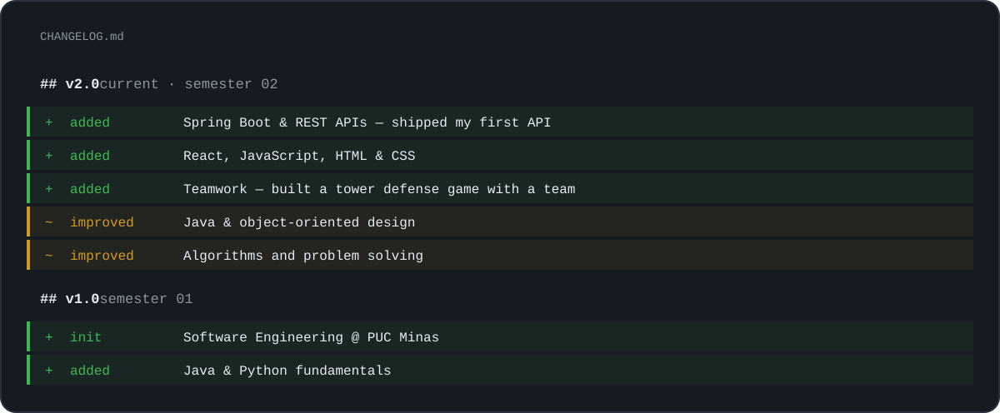
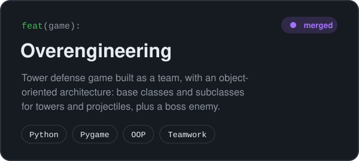
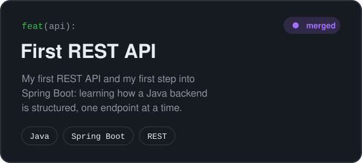

  

 

## 📦 Release notes

I'm a **Software Engineering student at PUC Minas**, now on **v2.0** (my second semester). I write most of my code in **Java** and **Python**, build interfaces with **React**, and I'm currently learning **Spring Boot**. Every semester ships a new version, and this page is the release log.

## ✨ Features

  
  

## 🐛 Known issues

- Can't resist one more refactor. See: [Overengineering](https://github.com/lucasdiasmz/-Overengeneering-).
- Spring Boot module is still in beta: expect breaking changes while I learn.

## 🗺️ Roadmap

- [x] Ship a first REST API with Spring Boot
- [ ] Connect a React front end to a Spring Boot API
- [ ] **v3.0:** land a first internship

## 🧩 Dependencies

| Runtime | Web | Dev tools | Beta |
| :-: | :-: | :-: | :-: |
|  |  |  |  |

## 🤝 Contributing

Pull requests welcome, and so are conversations about software, study groups and **internship opportunities**. Open an issue on [LinkedIn](https://www.linkedin.com/in/lucasdiasmz/) or by [email](mailto:lucasdiasmelo4@gmail.com).

<b>🇧🇷 Versão em português</b>

 

Sou estudante de **Engenharia de Software na PUC Minas**, no 2º período. Programo principalmente em **Java** e **Python**, e no front-end trabalho com **React, JavaScript, HTML e CSS**. Gosto de projetos em que criatividade e técnica precisam andar juntas, e agora estou aprendendo **Spring Boot** e APIs REST.

- **[Overengineering](https://github.com/lucasdiasmz/-Overengeneering-)**: jogo tower defense feito em grupo, com arquitetura orientada a objetos (classes base e subclasses para torres e projéteis, além de um inimigo boss). `Python` `Pygame`
- **[Primeira REST API](https://github.com/lucasdiasmz/firstRestAPI-Spring)**: minha primeira API REST e meu primeiro passo no Spring Boot. `Java` `Spring Boot`

Estou aberto a conversas sobre desenvolvimento, grupos de estudo e **oportunidades de estágio**. Me chama no [LinkedIn](https://www.linkedin.com/in/lucasdiasmz/) ou por [e-mail](mailto:lucasdiasmelo4@gmail.com).

 <code>lucas@2.0</code> · next release: v3.0

